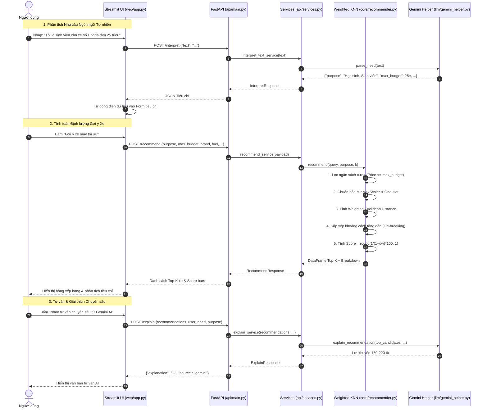

# KIẾN TRÚC HỆ THỐNG HỖ TRỢ RA QUYẾT ĐỊNH (DSS) GỢI Ý XE MÁY MULTI-TIER

Hệ thống kết hợp thuật toán tính toán định lượng **Weighted K-Nearest Neighbors (KNN)**, mô hình ngôn ngữ lớn **Google Gemini AI**, dịch vụ **FastAPI RESTful Microservice** và giao diện người dùng **Streamlit**.

---

## 1. Bối cảnh và Yêu cầu Tái cấu trúc Hệ thống

### 1.1. Bài toán thực tế
Trên thị trường xe máy Việt Nam, người mua đối mặt với hàng trăm mẫu xe (Honda, Yamaha, Suzuki, VinFast, Vespa, SYM, Piaggio, Dat Bike, Yadea) từ nhiều phân khúc giá (13 triệu đến hơn 1 tỷ đồng), đa dạng nhiên liệu (xăng, điện), kiểu dáng (xe số, tay ga, xe côn tay, xe điện, 50cc). Người mua thường:
- **Khó khăn trong so sánh đa mục tiêu:** Cân bằng giữa giá cả, công suất máy, dung tích cốp, thương hiệu và độ bền.
- **Diễn đạt nhu cầu theo ngữ cảnh đời sống:** Thay vì nhập thông số kỹ thuật khô khan, người dùng nói "tôi là sinh viên cần xe đi học bền bỉ dưới 30 triệu" hoặc "mua xe tay ga cho vợ cốp rộng đi chợ".
- **Cần lời khuyên khách quan có giải thích rõ ràng:** Không chỉ nhận về danh sách xe mà cần hiểu rõ lý do mẫu xe này được gợi ý đứng đầu.

### 1.2. Mục tiêu tái cấu trúc sang kiến trúc phân tầng (Multi-tier Architecture)
Chuyển đổi từ mô hình ứng dụng đơn khối (monolith) sang kiến trúc phân tầng chuyên nghiệp:
1. **Độc lập nền tảng (Platform Agnostic):** Tách toàn bộ nghiệp vụ toán học DSS và AI sang **FastAPI REST API**, sẵn sàng phục vụ Web (Streamlit), Mobile (Flutter, React Native) hoặc Desktop trong tương lai.
2. **Bảo mật tuyệt đối (Zero-leak Credential):** API Key của Gemini chỉ quản lý tập trung ở Server-side qua biến môi trường hoặc `keyapi.txt`, tuyệt đối không phơi bày ra Client Web.
3. **Tuân thủ nguyên lý DSS:** Thuật toán Weighted KNN chịu trách nhiệm 100% tính toán khoảng cách và điểm số định lượng. Gemini chỉ đóng vai trò bộ phân tích ngôn ngữ tự nhiên (NLP) và giải thích kết quả.
4. **Dễ bảo trì và kiểm thử:** 100% các tầng có bộ kiểm thử tự động (Unit Test, Math Hand-calc, API integration).

---

## 2. Kiến trúc Tổng thể Phân Tầng (Multi-tier Architecture)

```text
+-----------------------------------------------------------------------------------+
|                        PRESENTATION LAYER (Web UI / Clients)                     |
|  - Streamlit Application (web/app.py & proxy app.py)                              |
|  - Tương lai: Mobile App (Flutter), Desktop App, Web Single Page Application      |
+-----------------------------------------------------------------------------------+
                                        |  HTTP REST (JSON)
                                        v
+-----------------------------------------------------------------------------------+
|                           API LAYER (FastAPI Microservice)                        |
|  - Endpoints: /health, /model-info, /recommend, /interpret, /explain              |
|  - Schema Validation (Pydantic v2): Validate kiểu dữ liệu, ngưỡng, biên           |
|  - Dependency Injection & Service Layer (api/services.py)                         |
|  - Swagger UI / OpenAPI Spec (auto-docs: /docs, /redoc)                           |
+-----------------------------------------------------------------------------------+
                     |                                         |
                     v                                         v
+----------------------------------------+   +--------------------------------------+
|    RECOMMENDATION CORE & MODEL LAYER   |   |            LLM LAYER (AI)            |
|  - Core Recommender (core/recommender) |   |  - Gemini Helper (llm/gemini_helper) |
|  - Fitted Pipeline (model/knn_model)   |   |  - SDK: google-genai 1.0+            |
|  - Metadata Spec (model_metadata.json) |   |  - Auto-fallback: gemini-3.1-flash   |
|  - Hard Budget Ceiling vs Target Price |   |  - Regex Rule-based Parser Fallback  |
|  - Deterministic Tie-breaking          |   |  - Zero-leak Server-side Credential  |
+----------------------------------------+   +--------------------------------------+
                     \                                         /
                      \                                       /
                       v                                     v
+-----------------------------------------------------------------------------------+
|                                     DATA LAYER                                    |
|  - data/dataset.csv (225 bản ghi xe máy sạch, 22 chiều đặc trưng)                 |
|  - history.json (Lưu trữ phiên tư vấn người dùng an toàn)                         |
+-----------------------------------------------------------------------------------+
```

---

## 3. Cấu trúc Thư mục và Phân chia Trách nhiệm

```text
D:\TT\
├── data\
│   └── dataset.csv              # Dữ liệu 225 mẫu xe đã làm sạch chuẩn hóa
├── model\
│   ├── train_export.py          # Script huấn luyện tiền xử lý & trích xuất artifact
│   ├── knn_model.joblib         # Scaler, ma trận đặc trưng & candidate data đã tiền xử lý
│   └── model_metadata.json      # Metadata mô hình (version 2.0.0, 22 chiều, thống kê biên)
├── api\
│   ├── __init__.py
│   ├── schemas.py               # Pydantic schemas (Request, Response, DTOs)
│   ├── services.py              # Business services & Singleton MotoRecommender
│   └── main.py                  # FastAPI application, CORS, lifespan & router endpoints
├── core\
│   ├── __init__.py
│   └── recommender.py           # Thuật toán Weighted KNN, Hard Filter, Tie-breaking
├── llm\
│   ├── __init__.py
│   └── gemini_helper.py         # Client Google Gemini, Fallback model, Prompt NLP
├── web\
│   └── app.py                   # Giao diện người dùng Streamlit thuần REST Client
├── tests\
│   ├── test_data.py             # Kiểm thử làm sạch và cấu trúc dữ liệu
│   ├── test_weights.py          # Kiểm thử hồ sơ trọng số & phân bổ One-Hot
│   ├── test_recommender.py      # Kiểm thử thuật toán KNN & tính tay đối chiếu
│   ├── test_gemini_helper.py    # Kiểm thử NLP parser & mock ngoại lệ Gemini
│   ├── test_history.py          # Kiểm thử lưu trữ phiên tư vấn
│   └── test_api.py              # Kiểm thử tích hợp toàn bộ các endpoint FastAPI
├── docs\
│   ├── ARCHITECTURE.md          # Tài liệu kiến trúc phân tầng
│   ├── MATHEMATICAL_MODEL.md    # Tài liệu cơ sở toán học & MCDM
│   └── TEST_REPORT.md           # Báo cáo kết quả kiểm thử tự động
├── app.py                       # Proxy script chuyển tiếp tương thích ngược
├── recommender.py               # Proxy module xuất khẩu từ core.recommender
├── gemini_helper.py             # Proxy module xuất khẩu từ llm.gemini_helper
├── history.py                   # Quản lý lịch sử truy vấn
├── requirements.txt             # Danh mục thư viện phụ thuộc theo tầng
├── README.md                    # Hướng dẫn cài đặt, khởi chạy và tài liệu API
├── run.bat                      # 1-Click launcher khởi động cả FastAPI và Streamlit
├── run_api.bat                  # Script khởi động riêng FastAPI backend
├── run_web.bat                  # Script khởi động riêng Streamlit frontend
└── run_test.bat                 # Script chạy toàn bộ 39 unit & API tests
```

---

## 4. Đặc tả REST API (FastAPI Backend)

Tất cả các endpoint đều hỗ trợ định dạng dữ liệu chuẩn JSON, có kiểm tra schema chặt chẽ bằng Pydantic và sinh tài liệu tương tác tại `http://127.0.0.1:8000/docs`.

### 4.1. `GET /health`
- **Mục đích:** Kiểm tra trạng thái hoạt động của hệ thống backend.
- **Response:**
  ```json
  {
    "status": "healthy",
    "version": "2.0.0",
    "records_count": 225,
    "feature_dim": 22
  }
  ```

### 4.2. `GET /model-info`
- **Mục đích:** Cung cấp thông tin cấu hình mô hình, các hồ sơ mục đích, danh mục hãng xe, nhiên liệu, kiểu dáng và khoảng giá trị số để Client tự động khởi tạo giao diện.
- **Response:**
  ```json
  {
    "version": "2.0.0",
    "dataset_records": 225,
    "feature_dimensions": 22,
    "purposes": ["Đi làm, đi phố & Gia đình", "Học sinh, Sinh viên", "Chạy dịch vụ & Tiết kiệm", "Phượt & Thể thao", "Thời trang, Sang trọng & Cao cấp"],
    "brands": ["Honda", "Yamaha", "Suzuki", "SYM", "Piaggio", "Vespa", "VinFast", "Yadea", "Dat Bike"],
    "fuels": ["Xăng", "Điện"],
    "body_styles": ["Tay ga", "Xe điện", "Xe côn tay", "Xe số", "Tay ga (50cc)", "Xe số (50cc)"],
    "numeric_ranges": {
      "Giá(VND)": {"min": 13800000.0, "max": 1200000000.0},
      "Công suất tối đa (Kw)": {"min": 0.4, "max": 160.0},
      "Dung tích cốp (L)": {"min": 0.0, "max": 37.0},
      "Năm sản xuất": {"min": 2022.0, "max": 2024.0}
    }
  }
  ```

### 4.3. `POST /recommend`
- **Mục đích:** Nhận các tiêu chí lựa chọn của người dùng, thực hiện lọc ngân sách và xếp hạng Weighted KNN.
- **Request Body:**
  ```json
  {
    "purpose": "Học sinh, Sinh viên",
    "max_budget": 35000000.0,
    "target_price": null,
    "brand": null,
    "fuel": "Xăng",
    "body_style": "Xe số",
    "min_power": null,
    "min_trunk": null,
    "year": 2024,
    "k": 5
  }
  ```
- **Response:**
  ```json
  {
    "total_matched": 18,
    "k": 5,
    "purpose": "Học sinh, Sinh viên",
    "results": [
      {
        "rank": 1,
        "model": "Honda Wave Alpha 110",
        "brand": "Honda",
        "price": 17859273,
        "fuel": "Xăng",
        "body_style": "Xe số",
        "power_kw": 6.12,
        "trunk_liters": 5.0,
        "year": 2024,
        "distance": 0.0412,
        "score": 96.0,
        "criteria_breakdown": [
          "Giá: 17,859,273 VNĐ (Thỏa ngân sách <= 35,000,000 VNĐ)",
          "Nhiên liệu: Xăng (Khớp yêu cầu: 100%) [✓]",
          "Kiểu xe: Xe số (Khớp yêu cầu: 100%) [✓]",
          "Năm sản xuất: 2024 (Khớp chính xác: 100%) [✓]"
        ]
      }
    ]
  }
  ```

### 4.4. `POST /interpret`
- **Mục đích:** Tiếp nhận văn bản ngôn ngữ tự nhiên từ người dùng, gọi Google Gemini để phân tích ngữ nghĩa và trích xuất cấu trúc tiêu chí JSON chuẩn hóa.
- **Request Body:** `{"text": "Tôi là sinh viên có khoảng 25 triệu cần mua xe số Honda đi học"}`
- **Response:**
  ```json
  {
    "purpose": "Học sinh, Sinh viên",
    "max_budget": 25000000.0,
    "brand": "Honda",
    "fuel": "Xăng",
    "body_style": "Xe số",
    "k": 5,
    "source": "gemini"
  }
  ```

### 4.5. `POST /explain`
- **Mục đích:** Gửi kết quả Top-K xe đã được thuật toán xếp hạng định lượng cho Google Gemini để sinh văn bản tư vấn và giải thích lý do lựa chọn.
- **Request Body:**
  ```json
  {
    "recommendations": [...],
    "user_need": "Tôi là sinh viên có 25 triệu...",
    "purpose": "Học sinh, Sinh viên"
  }
  ```
- **Response:**
  ```json
  {
    "explanation": "Dựa trên kết quả tính toán định lượng của hệ thống DSS, mẫu xe Honda Wave Alpha 110 đạt điểm phù hợp cao nhất (96.0%). Với ngân sách 25 triệu đồng, mức giá ~17.8 triệu giúp bạn tiết kiệm đáng kể chi phí... [150 - 220 từ]",
    "source": "gemini"
  }
  ```

---

## 5. Luồng Tương tác giữa các Thành phần (Sequence Diagram)



---

## 6. Các Quyết định Thiết kế và Nguyên tắc Bảo mật

### 6.1. Tách biệt Trần ngân sách tối đa (Ceiling Filter) và Giá mục tiêu (Target Price)
- Trong bài toán DSS, khi người dùng yêu cầu xe "dưới 45 triệu", 45 triệu là **trần ngân sách bắt buộc (Constraint)** chứ không phải giá tiền mong muốn. Một mẫu xe có giá 33.7 triệu (tiết kiệm hơn 11 triệu) là điều rất tốt, tuyệt đối không bị phạt khoảng cách vì rẻ hơn 45 triệu.
- `max_budget` chỉ được dùng để lọc điều kiện $Price(x) \le B$.
- Chỉ khi người dùng chủ động yêu cầu một mức giá mục tiêu cụ thể (`target_price`) thì thuật toán mới tính khoảng cách $|Price(x) - target\_price|$.

### 6.2. Trọng số Tiêu chí Hoạt động (Active Criteria Weighting)
- Tránh việc gán ngầm giá trị trung tính $0.5$ cho các thuộc tính số mà người dùng không quan tâm.
- Mọi tiêu chí ảnh hưởng đến khoảng cách xếp hạng đều được thể hiện minh bạch trong danh sách tiêu chí giải thích (`criteria_breakdown`).

### 6.3. Quy tắc Phá vỡ Hòa điểm Xác định (Deterministic Tie-breaking)
- Khi hai mẫu xe có cùng khoảng cách toán học ($|d_1 - d_2| < 10^{-6}$), hệ thống sắp xếp ưu tiên theo các tiêu chuẩn kinh doanh minh bạch:
  1. Năm sản xuất mới hơn xếp trước (DESC `Năm sản xuất`).
  2. Giá bán tiết kiệm hơn xếp trước (ASC `Giá(VND)`).
  3. Thứ tự bảng chữ cái theo tên mẫu xe (ASC `Tên xe`).

### 6.4. Bảo mật Khóa API (Zero-leak Policy)
- API Key được bảo vệ tuyệt đối ở tầng Server, nạp qua biến môi trường `GEMINI_API_KEY` hoặc file `keyapi.txt` tại thư mục gốc.
- Client Streamlit giao tiếp qua REST API, không lưu giữ và không thể truy xuất API Key.
- Khóa bí mật không bao giờ xuất hiện trong terminal log, Swagger documentation hay các file lưu trữ lịch sử (`history.json`).
